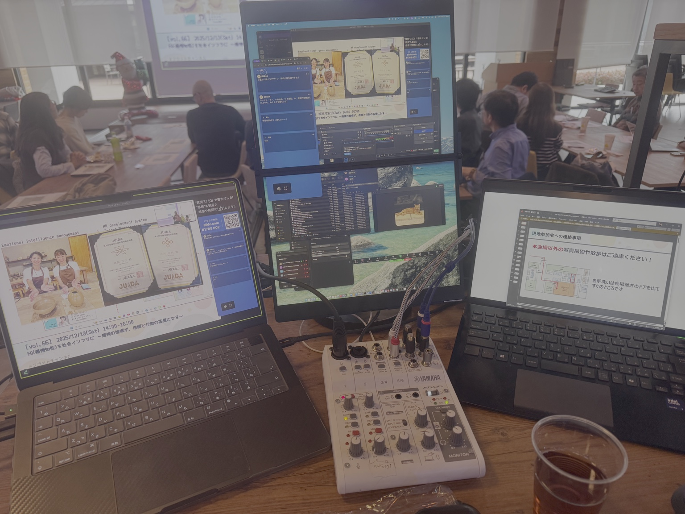
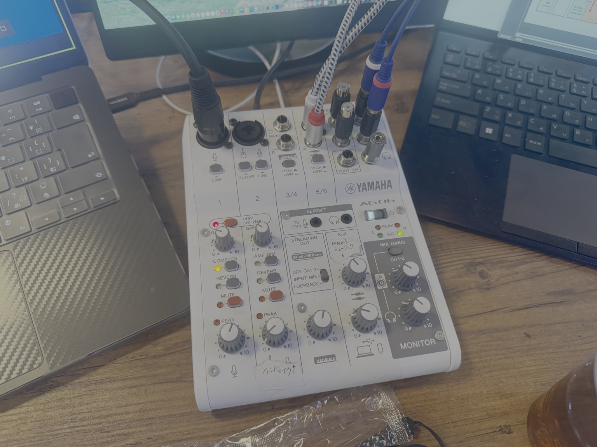

# 全体概要・用語

## 目的
- 機材の組み方・設定・当日運用を標準化し、**属人化を減らす**
- 会場ごとの差分を吸収し、**毎回同じ品質**で配信できるようにする

## 前提（今回の持ち込み機材）
- **YAMAHA AG06MK2**
- **ATEM Mini Pro**
- **MacBook Pro（配信PC）**
- **Anker 343 USB-C ハブ**
- **JSAUX FlipGo Pro（Macの外部モニター）**
- **kksmart モバイルモニター 13.3インチ 2.5K（ATEM HDMI OUT用）**
- **iPad Pro（カメラ用途：Blackmagic Cam）**
- **Windows PC（PowerPoint表示：スライド入力）**
- **AT2050 コンデンサーマイク**（卓上/会場近接の補助マイク）
- （付帯）USB-C→HDMIアダプタ、HDMI→USB-Aキャプチャ（ドングル）

## 会場設備（想定）
- プロジェクター（会場スクリーン）
- スピーカー（会場音響システムに接続済み）
- 無線マイク 4本（会場付属）
- ClickShare（配信用MacBook Proを **USB Type-C で接続**して無線投影）
- 演台システム（音声OUTあり）

## 命名ルール（ラベル）
- 映像：`V1` `V2` ...
- 音声：`A1` `A2` ...
- USB：`U1` `U2` ...
- 電源系統：`PWR-RED`（配信系） `PWR-WHT`（充電/雑多）

## 重要：運用ポリシー（ハウリング/ループ回避）
- **会場PA（会場スピーカー）は会場側で完結**させ、配信用には「演台OUTを分岐して取り込む」方針を基本とする。
- 配信音（Zoomのリモート音声など）を会場に返す必要がある場合は、電源を落とすかボリュームを下げてから実施する。

## 参考写真

