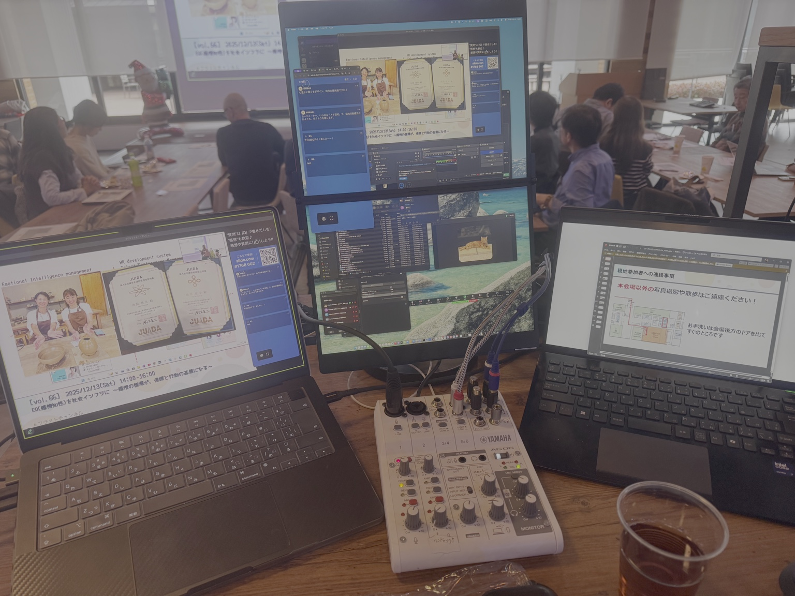

# 機材台帳（BOM）

> ここは「持ち物チェック」と「不足時の代替」を兼ねます。型番・数量は運用に合わせて追記。

## 1) コア機材
|カテゴリ|機材|数量|役割|備考/代替案|
|---|---|---:|---|---|
|映像|ATEM Mini Pro|1|スライド入力（IN1）→MacへUVC出力|ATEM Software Controlで設定|
|音声|YAMAHA AG06MK2|1|会場音声/卓上マイク→配信へ|CH5/6にRCA、CH1にXLR|
|配信PC|MacBook Pro|1|OBS/Zoom/配信|ClickShare接続も担当|
|USBハブ|Anker 343 USB-C ハブ|1|USB/HDMI/電源拡張|Macのポート不足を吸収|

## 2) 入力機材
|カテゴリ|機材|数量|役割|備考|
|---|---|---:|---|---|
|カメラ|iPad Pro + Blackmagic Cam|1|カメラ映像|HDMIキャプチャ経由でMac入力|
|スライド|Windows PC（PowerPoint）|1|スライド入力|ATEM HDMI IN1へ|
|音声|会場無線マイク|4|登壇音声|会場演台システムに接続済み（想定）|
|音声|AT2050 コンデンサーマイク|1|卓上/会場近接の補助|AG06 CH1 XLRへ|

## 3) 監視（モニター）
|カテゴリ|機材|数量|役割|備考|
|---|---|---:|---|---|
|モニタ|kksmart 13.3" 2.5K|1|ATEM HDMI OUT表示|マルチビュー/プレビュー|
|モニタ|JSAUX FlipGo Pro|1|Macの外部モニター|HDMI→miniHDMIで接続|

## 4) 変換・キャプチャ（要：現物固定）
|カテゴリ|品目|数量|役割|注意|
|---|---|---:|---|---|
|変換|USB-C→HDMIアダプタ|1|iPad映像出力|映像対応品を固定|
|キャプチャ|HDMI→USB-A キャプチャ|1|iPad映像をMacに取り込む|ドライバ不要のUVC推奨|

## 5) ケーブル
- HDMI（スライド→ATEM / ATEM→kksmart / iPad用）
- HDMI→miniHDMI（Mac→FlipGo）
- RCA 20m（演台OUT→AG06 CH5/6）
- XLR 15m（AT2050→AG06 CH1）
- USB-C（ATEM→Anker343、ClickShare→Mac、AG06→Mac など）

## 参考写真

